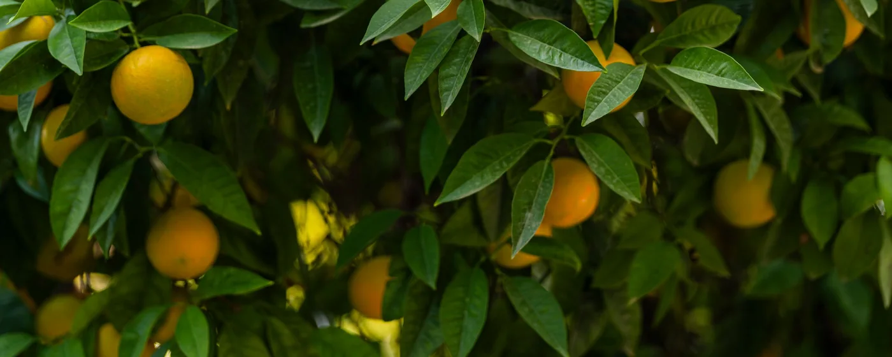

<p align="center">
  
</p>

<h1 align="center">CutieFarm</h1>

<p align="center">
  <strong>Know which oranges to pick and when to water.</strong><br />
  A grove that watches itself: a camera judges each orange, a few sensors watch the soil, and a Telegram bot tells the grower what to do.
</p>

<p align="center">
  <a href="https://cutiehacksproject.vercel.app"><strong>Live site</strong></a> ·
  <a href="https://t.me/CutieFarmGroveBot">Telegram bot</a> ·
  <a href="farm/README.md">Run it</a> ·
  Built at Cutiehacks 2026
</p>

<p align="center">
  <a href="https://cutiehacksproject.vercel.app">
    
  </a>
</p>

## What it does

| Question | How CutieFarm answers it |
|---|---|
| **Is this orange ready to pick?** | A webcam scans the tree. YOLO finds each orange, and a peel-colour check labels it **unripe**, **ripening** or **ready to pick**. |
| **Does the grove need water?** | An Arduino reads soil moisture, temperature and humidity. With the weather forecast, CutieFarm works out how often to water and when next. |

Every morning at 9:00 the Telegram bot sends the answer: *"3 ready to pick, 5 ripening. Water on Thursday: hot, dry week ahead, so twice a week for now."*

## Try it

- **Scan an orange in your browser.** The [live site](https://cutiehacksproject.vercel.app) has the same colour check running on your device. Frames never leave it.
- **Try the watering rule** on the site. Move the sliders for soil, heat, wind and rain and watch the schedule change.
- **Talk to the bot.** Open [@CutieFarmGroveBot](https://t.me/CutieFarmGroveBot) and tap Start. It runs on a team laptop, so it answers while that laptop is on.

## The bot

| | |
|---|---|
| `/status` | What's ready to pick and when to water, with buttons for watering details and a reminder |
| Ready-to-pick alerts | Sent as soon as the camera sees more oranges ready, without waiting for 9:00 |
| Ask in your own words | "¿y las de la izquierda?", "when should I water?", by text or voice note |
| Photo check | Send a photo of an orange and it gives its state, worked out on the laptop |
| `/water`, `/water_now` | Watering advice, and running the pump through the Arduino with safety limits (max time, cooldown, daily cap, never on wet soil) |
| `/picked 3`, `/watered`, `/week` | Log what you did and see a 7-day summary with a harvest forecast |

Until the camera and the sensors are wired in, the bot runs on demo data and simulated sensors, and every message says so.

## How it fits together

```
webcam ──► camera program (YOLO + colour check) ──► scans.jsonl ───┐
                                                                   ├──► Telegram bot ──► grower
Arduino ──USB──► sensor bridge ──► sensors.jsonl ◄── watering ─────┤
                                                                   └──► control room dashboard
```

The parts never call each other: they share append-only files in one data folder ([contract](farm/CONTRACT.md)). One command starts them all: `python -m farm`.

| Folder | What's in it |
|---|---|
| [`web/`](web/) | The landing page, the in-browser scanner and the watering simulator (Vite, vanilla JS), deployed on Vercel |
| [`farm/bot/`](farm/bot/README.md) | The Telegram bot: daily message, alerts, chat, voice, photos, harvest log, forecast, watering |
| [`farm/vision/`](farm/vision/README.md) | The camera program: YOLO finds the oranges, the colour check judges ripeness |
| [`farm/sensors/`](farm/sensors/README.md) | The Arduino serial bridge, simulator and reference sketch |
| [`farm/dashboard/`](farm/dashboard/README.md) | The control room for the big screen |
| [`ml/`](ml/) | Model experiments: YOLO detection and irrigation prediction |
| [`sketch_nov21a/`](sketch_nov21a/) | The Arduino sketch: soil sensor, DHT11 and motor |
| [`embedded/`](embedded/) | The STM32 Nucleo port, work in progress |

## Run it

On Windows, from the repo root:

```powershell
powershell -ExecutionPolicy Bypass -File farm\demo.ps1 -InstallOnly   # once: installs everything (YOLO and torch take a while)
powershell -ExecutionPolicy Bypass -File farm\demo.ps1 -Camera        # bot + camera + simulated sensors + dashboard
```

The bot needs `farm\bot\.env` with a Telegram bot token (an OpenAI key is optional, for chat and voice). See [`farm/README.md`](farm/README.md) for every option, and [`web/`](web/) for the site (`npm install && npm run dev`).

## Honest limits

- Ripeness comes from peel colour. Warm or cool light shifts colours, and a green orange among green leaves is hard to see.
- Watering advice is a rule of thumb from soil moisture, weather and a citrus crop coefficient. It's not an agronomist.
- The chat model only sees the latest farm summary, and it says when the data is demo or simulated.

## Credits

Built at Cutiehacks 2026 by [the CutieFarm team](https://github.com/Kaede106/Cutiehacksproject/graphs/contributors). The hero photo by Engin Akyurt is from [Pexels](https://www.pexels.com/photo/ripening-tangerines-on-the-tree-branches-19789689/) ([details](web/public/CREDITS.md)). Orange detection uses [Ultralytics YOLO](https://github.com/ultralytics/ultralytics), and the forecast comes from [Open-Meteo](https://open-meteo.com).
